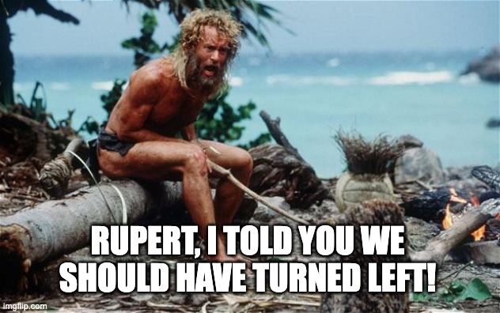
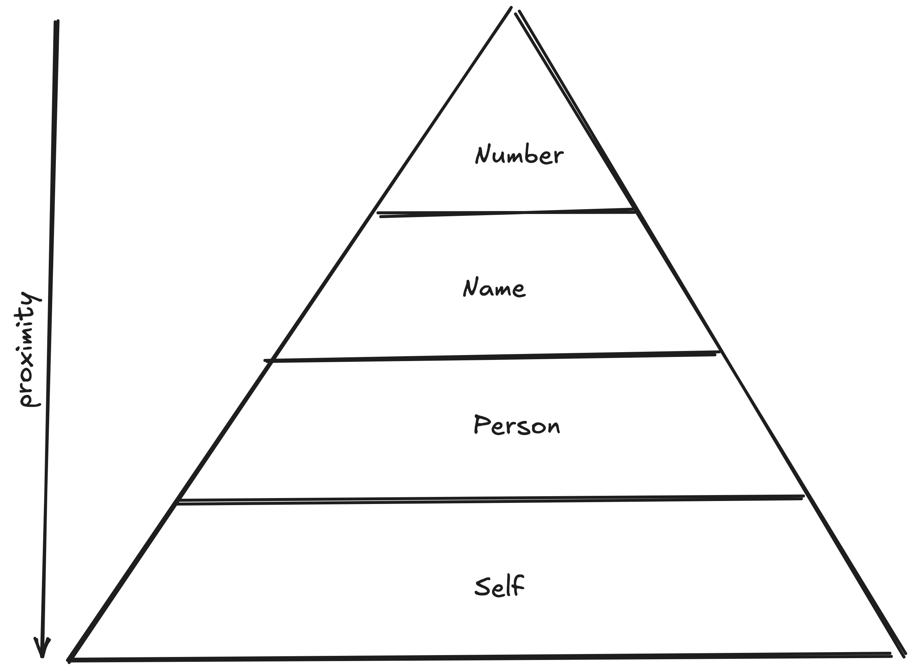

+++
title = 'Proximity Bias In Performance Reviews'
date = 2026-11-09T07:34:21+01:00
lastmod = 2026-11-09T07:34:21+01:00
description = "Understanding how seemingly unfair decisions are created from above and how to influence it"
draft = false
tags = ["coaching", "engineering", "advice", "bias"]
author = "bjoern"
comment = false
toc = true
image = "cover.jpg"
+++

Last month I finished my 8th performance review cycle on the side of management. 
A question that bothered me for the first 6 iterations: Why is it so easy for people on the upper levels to enforce harsh decisions on the lower levels?

## Rupert
When I was 18, I messed up a lot and forgot my ID card when I tried to visit a club with friends. 
The actual bigger problem was: we went there by car and my friends (today not my friends anymore) decided they would visit the club anyways and then pick me up in about five hours. 

It was night and cold. And, for full disclosure, I wasn’t quite sober. So in my intoxicated state I decided: 
Fuck it, I’d rather walk home than wait 

Which is exactly what I did. I walked. The trip took me roughly four hours and my feet hurt a lot. Luckily, I didn’t have to endure it alone. Because after about one hour I found an excellent stick. Half an hour later I named it “Rupert” and engaged in an exciting conversation. 

Rupert stayed with me for a few weeks, because I had a hard time getting rid of it. I mean, Rupert accompanied me during a hard night, just throwing it away would be heartless. My father however had a very easy time throwing the stick away. To him it was just another stick.

The lesson to learn here: I shouldn’t have named Rupert. Giving it a name and personality created an emotional attachment. 

## Proximity Levels
Now ride along with me on a very hard topic change: what can we learn from Rupert about performance reviews? 
It all revolves around being attached. 
The closer you are to a person, the harder it is for you to make a decision. 
The less you know, the easier it is. 
This is proximity bias.

During my career, I have observed four levels of proximity in performance reviews: 
1. Self. The first layer is the one with the strongest attachment - This is yourself. Of course you think the best of yourself.
2. Person. The second layer is your manager. This person knows your name, what you look like and has regular contact with you. 
3. Name. The third layer is your manager's manager. They know your name and maybe they have seen you every now and then. You rarely talk with each other. Mostly, you are a name to them.
4. Number. The last layer is every manager above your manager's manager. These people mostly have no clue that you exist. To them, you are somebody who makes the team headcount go +1

Imagine you are managing a team of 6 as direct manager.
You are level 2. 
Performance Review season comes around and you can nominate one person from your team for promotion. 
The problem is, you have 3 people you consider for this. But you can pick only one. 
You pick Alice with a heavy heart, because Bob and Charlie also deserve it.

Your manager is responsible for 4 teams. Across these 4, they can hand out 2 promotions.
This naturally evolves into each manager pitching their nominee. Since your manager knows none of the nominees personally, they need to rely on these pitches. In the end the decision falls to Daves, from another team, and Alice, from your team.

One level further up, somebody is looking at a spreadsheet and realises that there is wiggle room for an exception to give out one more promotion across several groups. This exception is granted to an engineer the top-level manager knows.

If this feels like favouritism, well, yes, it is. 
I am not advocating that this is a good system, I am saying that it simply exists. Proximity bias exists, whether you like it or not. 
You cannot level the playing field by trying to remove it. 
Instead, you should aim to achieve more equal proximity.

## Become a person

Most of the time, I sit on level 2 when making decisions. 
This is also because I drink my own poison - I was once involved in an evaluation for a team I didn't know (so I was level 3) and it was a frightening experience. 
It was incredibly easy to rate people. Most of them were names on a screen, but two had reached out for a coffee chat some weeks prior. 
I could really feel how I was biased towards rating them more positively than the others.
It also had a very bitter feeling that evening, because my decision would affect the life of somebody (for better or worse) and it was based on whatever my gut told me. 

While this sounds very disheartening, there is an upside: you have the power to influence this gut feeling in your favour. 
When a manager needs to make a decision and there are only names on the list, they are more likely to make a positive decision for somebody they feel like they know. 
Make proximity bias work in your favour. 

Schedule a coffee chat with your manager's manager.
Present something in a meeting where your manager's manager is also present.
This may feel like sucking up to somebody, but I like to frame it as increasing the odds in your favour. 
You don't aim to become a leech. You just want to turn from "Name" to "Person". Once you have a foot in the door, you can actually make your work visible. 
Once you have that covered, ask for help to figure out how you can make your work visible on the next level. To make the process fairer, you need to make sure the people making decisions actually know who their decision affects. 

PS: And if you sit on level 3 - Try to have skip-level meetings every now and then. 
